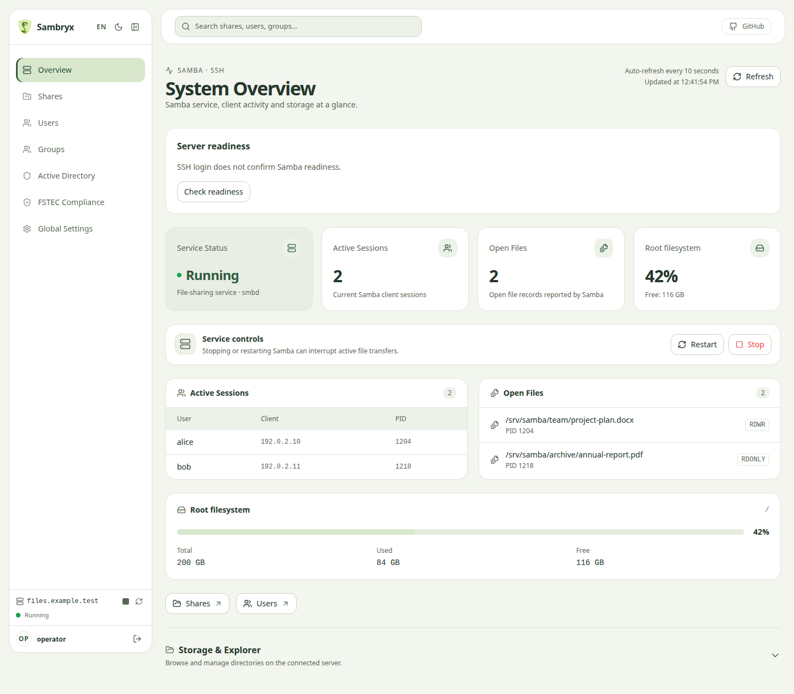

**English** | [Русский](README.ru.md)

<p align="center">
  
</p>

<p align="center">
  
  
  
  
  
</p>

<p align="center">
  
</p>

*Dashboard preview with demo data.*

**Sambryx** is a web control panel for Samba file servers on Linux.
It lets administrators manage shares, accounts, access permissions and global
`smb.conf` settings through SSH. Docker is the primary distribution format.

## Documentation

The **[documentation](https://AndreyJVM.github.io/sambryx/)** provides user guides,
configuration instructions and architecture details. The linked guides are in Russian.

## Docker installation

For one administrator with an existing Samba server, start with the
[quick start](docs/quickstart.md): a prebuilt image, Docker Compose and HTTPS through Nginx.
The panel host needs Docker Engine, Compose and a trusted TLS certificate;
JDK, Maven and Node.js are not required for installation.

Before signing in, prepare the [server](docs/server-setup.md) and
[trusted SSH host keys](docs/ssh-host-keys.md). Sign in with the server's SSH credentials;
there is no separate panel account.

The [production guide](docs/production.md) covers installation commands, `.env`,
readiness checks and an optional bundled Samba node.
For an existing installation, see [migration to Sambryx](docs/renaming.md).

## Local development and testing (Sandbox)

The isolated Sandbox starts a Samba/SSH server container and builds a local panel image,
so you can test without changing your real server. Use the launcher to build the environment,
wait for services and remove temporary containers, networks and volumes when finished.

**Linux / macOS:**
```bash
./scripts/sandbox/run-sandbox.sh
```

**Windows (Git Bash / WSL):**
```bash
bash scripts/sandbox/run-sandbox.sh
```

### How the Sandbox works

1. Builds frontend and backend on the host using the local Maven `.m2` cache.
2. Starts Docker Compose services:
   - `samba-node`: Ubuntu with Samba and SSH (SSH port `2222`, SMB ports `1445` and `1139`).
   - `web`: the local panel at `http://localhost:8080/ui`.
3. Removes temporary containers and volumes when the launcher exits (Ctrl+C or Enter).

See [docker/README.md](docker/README.md) for details and configuration options.

## Distribution

Sambryx ships as a Docker image with JRE 21 and manages Samba servers over SSH.
Java is not required on the managed server. A single standard panel image is used;
Debian/Ubuntu are the target server and host families.
Test environments use Ubuntu 22.04 and 24.04 Samba nodes; this does not establish
support for every Debian/Ubuntu version. See the [distribution guide](docs/distribution.md)
for validation limits and Astra status.

## Development

Docker uses the packaged JAR with the frontend included. Run `./mvnw clean package`
before building a local Docker image. The [distribution guide](docs/distribution.md)
describes artifact checks and packaging commands.

### Requirements

- Java 21 (JDK)
- Node.js 20+ and npm 10+
- Docker and Docker Compose (for Sandbox)
- Python 3 (for JAR validation in Sandbox)

### Build

```bash
# Build without tests
./mvnw clean package -DskipTests

# Run tests
./mvnw test

# Check code style (Spotless)
./mvnw spotless:check

# Apply formatting
./mvnw spotless:apply
```

### Run the backend from an IDE

Main class: `mari.samba.SambryxApplication`.

Build the frontend first (`cd frontend && npm run build`), or start the Vite development server:

```bash
cd frontend
npm run dev
```

Vite serves `http://localhost:5173/ui/` and proxies API requests to `http://localhost:8080`.

## Browser testing

Browser smoke tests use Java/JUnit and Playwright against the built UI with isolated API
fixtures; no Samba server is needed. See the [testing guide](docs/testing.md) for commands,
coverage boundaries and CI troubleshooting.

## License

Distributed under the MIT License. See [LICENSE](LICENSE).
