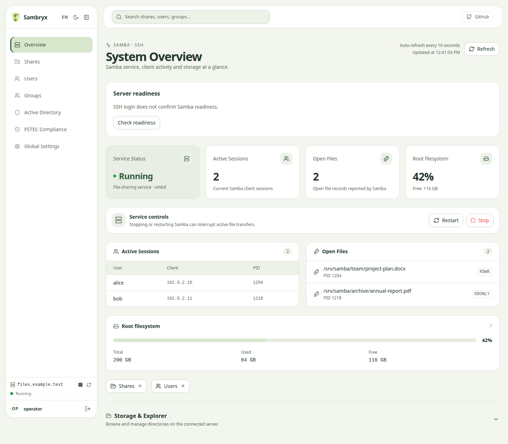

[English](README.md) | **Русский**

<p align="center">
  
</p>

<p align="center">
  
  
  
  
  
</p>

<p align="center">
  
</p>

*Обзор Dashboard с демонстрационными данными.*

**Sambryx** — это современная веб-панель управления файловыми серверами Samba на Linux.
Позволяет системным администраторам централизованно управлять каталогами, учетными записями,
правами доступа и глобальными параметрами `smb.conf`. Управляемый сервер подключается по SSH. Основной способ поставки панели — Docker.

## Документация

Полное руководство пользователя, инструкции по настройке и описание архитектуры доступны в **[документации](https://AndreyJVM.github.io/sambryx/)**. Связанные руководства написаны на русском языке.

## Установка с Docker

Для одного администратора с существующим Samba-сервером начните с
[быстрого старта](docs/quickstart.md): готовый образ, Docker Compose и HTTPS через Nginx.
На машине с панелью нужны Docker Engine, Compose и доверенный TLS-сертификат;
JDK, Maven и Node.js для установки не нужны.

Перед первым входом подготовьте [сервер](docs/server-setup.md) и
[доверенные SSH-ключи](docs/ssh-host-keys.md). Форма принимает SSH-реквизиты сервера;
отдельная учётная запись панели не создаётся.

[Production-инструкция](docs/production.md) содержит команды установки, `.env`,
проверку готовности и дополнительный вариант со встроенным Samba-узлом.
При обновлении существующей установки см. [переход на Sambryx](docs/renaming.md).

## Локальная разработка и тестирование (Sandbox)

Изолированный Sandbox поднимает контейнер с сервером Samba/SSH и собирает локальный образ
панели для тестирования без изменения настроек реального сервера. Используйте скрипт запуска:
он собирает окружение, ждёт готовности сервисов и удаляет временные контейнеры, сети и тома
после завершения работы.

**Linux / macOS:**
```bash
./scripts/sandbox/run-sandbox.sh
```

**Windows (Git Bash / WSL):**
```bash
bash scripts/sandbox/run-sandbox.sh
```

### Как работает Sandbox
1. **Сборка фронтенда и бэкенда** на хосте с локальным Maven-кешем `.m2`.
2. **Docker Compose** поднимает:
   - `samba-node`: Узел Ubuntu с реальным Samba-сервером и SSH (порт `2222` и SMB `1445`, `1139`).
   - `web`: Локальный контейнер Web UI на `http://localhost:8080/ui`.
3. **Автоматическая очистка**: при завершении скрипта (Ctrl+C или Enter) скрипт вычищает все временные контейнеры и тома.

Подробнее о песочнице и параметрах читайте в [docker/README.md](docker/README.md).

## Способ поставки

Sambryx поставляется в Docker-образе с JRE 21 и управляет Samba-серверами через SSH.
Java на управляемом сервере не требуется. Используется один стандартный образ;
Debian/Ubuntu — целевые семейства серверов и хостов, без отдельных образов панели.
Стенды используют Samba-узлы Ubuntu 22.04 и 24.04; это не подтверждение всех версий
Debian/Ubuntu. Границы проверок и статус Astra приведены в [руководстве по поставкам](docs/distribution.md).

## Разработка

Docker использует собранный JAR с frontend. Перед локальной сборкой Docker-образа
выполните `./mvnw clean package`. Проверки артефактов и команды упаковки описаны в
[руководстве по поставкам](docs/distribution.md).

### Требования
- Java 21 (JDK)
- Node.js 20+ и npm 10+
- Docker и Docker Compose (для запуска Sandbox)
- Python 3 (для проверки JAR в Sandbox)

### Сборка проекта
```bash
# Build without tests
./mvnw clean package -DskipTests

# Run tests
./mvnw test

# Check code style (Spotless)
./mvnw spotless:check

# Apply formatting
./mvnw spotless:apply
```

### Запуск бэкенда из IDE
Основной класс: `mari.samba.SambryxApplication`

Перед запуском из IDE убедитесь, что фронтенд собран (`cd frontend && npm run build`), либо запустите Vite dev-сервер:
```bash
cd frontend
npm run dev
```
Vite dev-сервер доступен на `http://localhost:5173/ui/` с автопроксированием API-запросов на `http://localhost:8080`.

## Тестирование интерфейса

Для браузерных smoke-тестов не нужен Samba-сервер: Java/JUnit и Playwright проверяют собранный UI с
изолированными API-фикстурами. Команды запуска, границы покрытия и диагностика CI описаны
в [руководстве по тестированию](docs/testing.md).

## Лицензия

Распространяется под лицензией MIT. Подробнее см. в файле [LICENSE](LICENSE).
