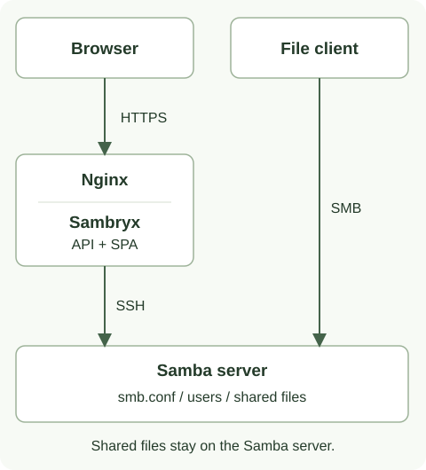
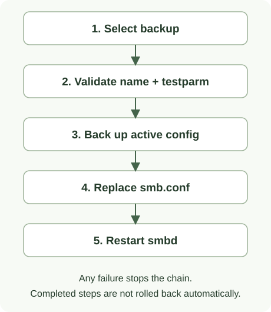

# Архитектура Sambryx

Панель состоит из React SPA и Spring Boot API в одном JAR и Docker-образе.
Samba работает отдельно; панель выполняет административные команды только через SSH.

## Компоненты и данные

| Компонент | Назначение | Где находятся данные |
| --- | --- | --- |
| Браузер | React/TypeScript, форма подключения, интерфейс управления | Серверная сессия определяется cookie; UI не является источником разрешений. |
| Nginx | HTTPS и проксирование к API/SPA | TLS-файлы подключаются с хоста. |
| Sambryx | Java 21, Spring Boot 3.4.0, Spring Security | HTTP/SSH-сессии находятся в памяти процесса. |
| `known_hosts` | Доверенные публичные ключи SSH-серверов | Файл на Docker-хосте, read-only подключение в панель. |
| Samba-сервер | SSH, Samba, файловая система, локальные пользователи и группы | `smb.conf`, его backup, базы Samba и пользовательские файлы остаются на сервере. |

Пересоздание контейнера панели завершает её сессии, но не удаляет данные Samba.
При встроенном Samba-узле его конфигурация, идентичности и файлы хранятся в отдельных
постоянных томах. Состав томов и правила обновления — в [Production Compose](production.md).

## Путь запроса

1. SPA обращается к `/api/` через `frontend/src/lib/api.ts`. Для изменяющего запроса
   клиент получает cookie `XSRF-TOKEN` и передаёт `X-XSRF-TOKEN`; при отсутствии токена
   запрос не отправляется. Публичный вход также защищён CSRF.
2. Spring Security и проверка серверного срока сессии допускают запрос к контроллеру.
   Контроллер передаёт идентификатор сессии сервису нужной функциональной области.
3. Сервис вызывает `CommandExecutor`. `ExecutionSessionManager` контролирует жизненный цикл
   операции и направляет её в `SshSessionManager`; команды формируются через `LinuxCommands`.
4. SSH-сервер выполняет команду с правами подключённого пользователя и разрешениями sudo.
   Backend получает exit code и вывод, формирует ответ API.
5. UI показывает результат. Изменяющие запросы автоматически не повторяются:
   потеря ответа не доказывает, что действие не выполнилось.

## Границы безопасности

- SSH-хост проверяется по `known_hosts`; принятие нового ключа из UI не предусмотрено.
- Вход использует SSH-реквизиты сервера. Отдельной базы пользователей панели нет.
- По умолчанию сессия истекает после 15 минут бездействия. Уже принятая операция имеет
  ограниченный период завершения; подробности — в [правилах сессий](sessions.md).
- Production Nginx заменяет forwarded-заголовки. Прямой HTTP-доступ к backend не публикуется.
  Лимит входа использует `getRemoteAddr()`; корректность адреса зависит от настройки прокси.
- Возможность команды определяется sudo policy сервера. Успешный SSH-вход или чтение файла
  не подтверждают право записи, восстановления или перезапуска службы.
- Файловый менеджер ограничен разрешёнными корнями; символические ссылки разрешены только
  при нахождении разрешённого конечного пути внутри этих корней.

## Конфигурация и восстановление

`SmbConfParser` разбирает и изменяет `smb.conf`; `SambaConfigService` читает, сохраняет
и восстанавливает его через SSH.

При сохранении создаётся backup, содержимое записывается во временный файл
`/tmp/smb.conf.tmp`, проверяется `testparm`, переносится в целевой путь и перезапускается `smbd`.

При восстановлении сначала проверяются имя и синтаксис выбранной копии, затем создаётся
копия текущей конфигурации, заменяется целевой файл и перезапускается служба.
Хранятся 10 новейших обычных backup-файлов. Ошибка этапа прекращает цепочку;
предыдущие действия автоматически не откатываются. Ручной backup не применяет форму
и не перезапускает Samba. Подробности — в [руководстве по копиям](configuration-backups.md).

## Структура исходников

| Путь | Содержимое |
| --- | --- |
| `frontend/src/pages/`, `components/`, `lib/` | Страницы, компоненты, HTTP-клиент и локализация |
| `src/main/java/mari/samba/auth/`, `session/`, `config/` | Аутентификация, серверные сессии, Security и настройки |
| `share/`, `user/`, `group/`, `filesystem/` | Ресурсы, локальные учётные записи и файловые операции |
| `smbconfig/`, `monitoring/`, `ad/`, `fstec/` | Конфигурация, мониторинг, доменные операции, анализ правил |
| `infra/`, `core/` | SSH, команды, парсер, ответы и исключения |
| `src/test/java/` | Backend unit/component/integration tests |
| `tools/browser/` | Отдельный Java/JUnit/Playwright-проект, HTTP API подменён |
| `tools/smoke/` | Отдельный Java/JUnit-проект, Docker и реальный Compose TLS/SSH/SMB |
| `scripts/ci/` | Классификация CI, проверки документов/артефактов и публикация |
| `deploy/production/` | Nginx, шаблоны окружения и тестовый Samba-узел |

## Сборка и проверки

Maven устанавливает локальные Node/npm, выполняет `npm install` и `npm run build`,
копирует `frontend/dist` в JAR. Dockerfile упаковывает готовый JAR с JRE 21;
Maven и Node в образе выполнения не нужны.

Backend проверяется JUnit, Mockito и Spring Security Test. Frontend имеет Node unit-тесты,
ESLint и Java-браузерные сценарии. Compose smoke отдельно проверяет настоящие TLS/SSH/SMB,
сохранность данных и backup/restore. Эти уровни не взаимозаменяемы и не доказывают
работу на любой ОС или в реальном домене AD.

Команды — в [разработке](development.md) и [тестировании](testing.md).
Выбор jobs и выпуск по тегу — в [поставке](distribution.md).
