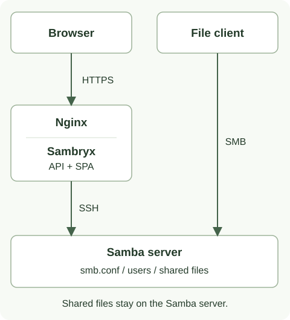

# Sambryx

Sambryx — веб-панель управления Samba-сервером на Linux через SSH.
Основной сценарий: один администратор управляет своим файловым сервером.
Панель поставляется Docker-образом; агент и Java на Samba-сервере не требуются.

## С чего начать

| Задача | Инструкция |
| --- | --- |
| Установить панель из готового образа | [Быстрый старт](quickstart.md) |
| Подготовить SSH-пользователя и права | [Настройка сервера](server-setup.md) |
| Проверить подлинность SSH-сервера | [Доверенные ключи](ssh-host-keys.md) |
| Настроить HTTPS, Compose и постоянные данные | [Production Compose](production.md) |
| Создать ресурс и настроить доступ | [Общие папки](shares.md) и [права](permissions.md) |
| Создать пользователя или группу | [Пользователи и группы](users-groups.md) |
| Разобраться с ошибкой | [Типовые проблемы](troubleshooting.md) |
| Собрать проект или предложить изменение | [Разработка](development.md) |

## Что умеет панель

- Создавать и изменять общие ресурсы Samba, настраивать их параметры доступа.
- Управлять локальными пользователями, группами и членством.
- Читать и изменять глобальную конфигурацию `smb.conf`.
- Создавать и восстанавливать [копии конфигурации](configuration-backups.md).
- Показывать состояние Samba, подключения и использование дисков.
- Выполнять [диагностику отказа доступа](access-diagnostics.md) без исправления прав.
- Проверять отдельные условия готовности сервера после SSH-входа.

Браузер управляет сервером через панель. Файловый клиент обращается к Samba напрямую
по SMB: пользовательские файлы не хранятся в контейнере панели.

## Версия документации и ограничения

Этот сайт публикуется из `master` и может описывать изменения, которых ещё нет в
[последнем релизе](https://github.com/AndreyJVM/sambryx/releases).
Проверяйте release notes выбранного Docker-тега. Например, ручное создание backup в UI
и панель проверки готовности добавлены после `v0.14.0`.

| Область | Текущее ограничение |
| --- | --- |
| SSH | Требуется независимо проверенный `known_hosts`; неизвестный или изменённый ключ блокирует вход. |
| Готовность | Проверяются отдельные операции чтения; полные права администрирования не подтверждаются. |
| Backup | Копируется `smb.conf`, а не данные ресурсов, учётные записи или ACL. |
| AD | Есть операции join/leave; работа с реальным доменом ещё не подтверждена. DNS/Kerberos в AD-статусе — заглушки. Проверка: [#64](https://github.com/AndreyJVM/sambryx/issues/64). |
| ОС | Контейнерные стенды Ubuntu не доказывают поддержку всех Debian/Ubuntu. Astra Linux ожидает проверки: [#10](https://github.com/AndreyJVM/sambryx/issues/10). |

Проверка синтаксиса через `testparm` не гарантирует доступ пользователя к файлам.
Последовательность SSH-команд не является транзакцией с автоматическим откатом.
Границы безопасности и поведения сессий описаны в [архитектуре](architecture.md)
и [правилах сессий](sessions.md).
