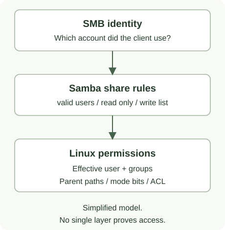

# Права доступа к ресурсу

Открытие ресурса зависит от SMB-аутентификации, настроек Samba и прав файловой системы.
Успех одной проверки не подтверждает остальные.



## Что проверять

| Уровень | Вопрос |
| --- | --- |
| Идентичность SMB | Под каким пользователем клиент действительно подключён? Нет ли сохранённых старых реквизитов? |
| Конфигурация ресурса | Разрешён ли ресурс, входит ли пользователь в `valid users`, нет ли запрещающего правила? |
| Группы | Каково фактическое членство пользователя? Совпадает ли имя группы с реальной Linux-группой? |
| Файловая идентичность | Заданы ли `force user` / `force group`, меняющие пользователя или группу операций? |
| Каталоги пути | Есть ли право `x` на каждом родительском каталоге? |
| Сам объект | Допускают ли mode bits и ACL нужные операции над каталогом и файлом? |

Видимость ресурса в списке не означает право открытия. `browseable=no` скрывает ресурс,
но не является запретом обращения по имени. Успешный `testparm` подтверждает принятие
конфигурации, а не доступ конкретного пользователя.

## Чтение и запись

- Для прохода через каталог нужно `x`; для просмотра его списка — `r` вместе с возможностью прохода.
- Для чтения файла нужно право чтения файла и прохода по всем родителям.
- Для создания файла обычно нужны `w` и `x` на целевом каталоге и разрешение Samba.
- `read only` / `write list` регулируют Samba, но не обходят ограничения Linux.
- `create mask` / `directory mask` не пересчитывают права всех существующих файлов.
  Сохранение ресурса в Sambryx не меняет права и владельцев существующих объектов.
  Для отсутствующего пути создаются каталоги с правами по правилам сервера —
  см. [последствия сохранения](shares.md).
  Это поведение доступно с `v0.15.1`; в `v0.15.0` сохранение ещё может применять
  `chmod` и рекурсивный `chown`.

Не используйте `chmod -R 777` для исправления отказа: он открывает права всем
и изменяет вложенные объекты. Сначала установите нужную идентичность, объект и причину.

## Практический порядок проверки

1. Уточните ресурс, пользователя, клиент и требуемое действие: открыть, прочитать или записать.
2. В UI выберите **Проверить доступ** для ресурса и явно задайте локального пользователя.
3. Сопоставьте найденные факты с реальным SMB-подключением. Диагностика панели не вычисляет
   группы, AD, ACL и доступ от имени пользователя; [полные границы отчёта](access-diagnostics.md).
4. На Samba-сервере проверьте идентичность и путь. Например:

```bash
id alice
getent group smb_accounting
namei -l /srv/samba/documents
stat /srv/samba/documents
```

5. Если используются ACL, проверьте их средствами администрирования сервера;
   простой вывод `stat` не описывает весь набор разрешений.
6. Изменяйте только подтверждённую причину. После изменения создайте новое SMB-подключение
   и проверьте разрешённого и постороннего пользователя.

Наличие `force user`/`force group` требует проверки назначенной файловой идентичности;
одного `id alice` тогда недостаточно. Отказ в тесте от имени исходного Linux-пользователя
сам по себе не доказывает отказ Samba при этих настройках.
